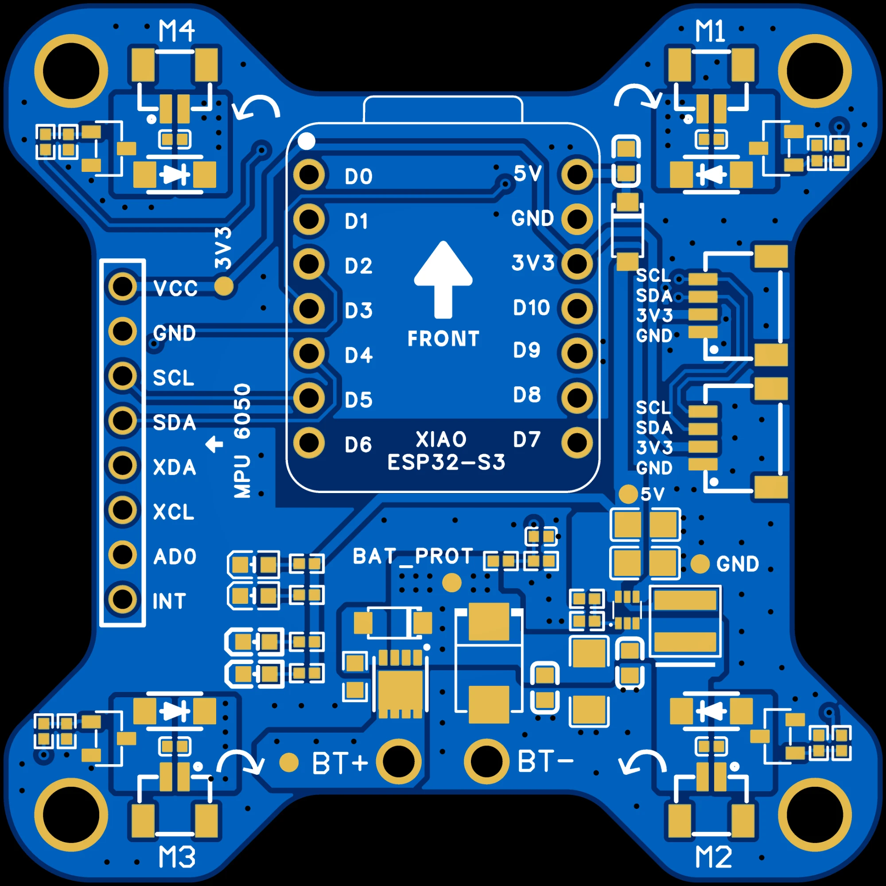

# XIAO S3 Drone

An open-source micro drone built around the **Seeed XIAO ESP32-S3**. You fly it from your
phone over Wi-Fi. No radio transmitter, no receiver, no soldering of a flight controller
from scratch. Made by **The Drone Community** for workshops and first builds.

## What it can do

- **Fly from a phone.** The drone makes its own Wi-Fi network; the Android app connects to it.
  iPhones can fly it with Espressif's free ESP-Drone app.
- **Stays safe on its own.** It starts disarmed, disarms itself when idle, lands by itself if
  the phone disconnects or the battery runs low, and has a one-touch motor stop.
- **Altitude hold** (optional). Plug a VL53L1X or VL53L0X distance sensor into the Qwiic port
  and the drone holds its height, with a Take off button in the app.
- **Live video** with the XIAO ESP32-S3 Sense camera: watch, take photos, record video.
- **Tools in the app:** motor test, level calibration, flying styles (Beginner, Normal, Sport),
  find-my-drone beeper, Wi-Fi name and password, firmware updates over Wi-Fi.

## What's in this repo

| Folder | What's inside |
|---|---|
| [`hardware/`](hardware/) | The PCB: schematic, Gerber files, bill of materials, pick-and-place, 3D model |
| [`frame/`](frame/) | A 3D-printable TPU frame for 8520 motors and 75 mm props |
| [`firmware/`](firmware/) | The flight software that runs on the XIAO (ESP-IDF) |
| [`android-app/`](android-app/) | The Android app (Android Studio project) |
| [`docs/`](docs/) | Install guide and quick guide (printable PDFs), developer notes |
| [`tools/`](tools/) | Release packaging, IMU orientation viewer, changelog |

## I just want to fly

1. Download the latest files from the [Releases](../../releases) page: the firmware zip and
   the app zip.
2. Follow the **[Install Guide](docs/install-guide/TDC_XIAO_S3_Drone_Install_Guide.pdf)**
   (2 pages). It covers flashing, Android, iPhone, the checks before the first flight and
   troubleshooting.

The **[Quick Guide](docs/quick-guide/XIAO_S3_Drone_Quick_Guide.pdf)** explains the board,
the wiring, the status lights and how to program it.

## Build your own

### 1. Get the board

Order PCB1 from any PCB fab with the files in [`hardware/`](hardware/). The
[hardware guide](hardware/README.md) walks you through ordering the bare board or a board
with the small parts already fitted, and lists every part.

### 2. Gather the other parts

- Seeed XIAO ESP32-S3 (or XIAO ESP32-S3 Sense for video)
- GY-521 MPU-6050 module
- 4 × 8520 coreless motors (2 clockwise, 2 counter-clockwise) and 4 × 75 mm props
- 1S LiPo battery with an XT30 plug
- The printed TPU frame from [`frame/stl`](frame/stl), and 4 M3 screws

### 3. Put it together

1. Solder the XIAO headers and the 8-pin IMU header if your board came without them.
2. Plug in the XIAO with its **USB-C end facing the front**.
3. Plug in the GY-521 module, flat on its header.
4. Fit the motors: **M1 front right and M3 rear left spin clockwise; M2 rear right and
   M4 front left spin counter-clockwise.** Plug each into its JST connector.
5. Screw the board onto the frame and fit the props to match the motors.

### 4. Flash the firmware

Plug the XIAO into a computer with **USB only, battery unplugged**, then run the flash script
from the firmware zip. The [Install Guide](docs/install-guide/TDC_XIAO_S3_Drone_Install_Guide.pdf)
has the exact steps for Mac, Linux and Windows.

> **Never connect USB and the battery at the same time.** They share the XIAO's 5 V line, so
> the computer would charge the battery and the USB port can shut down.

### 5. Fly

1. Unplug USB and connect the battery.
2. On your phone, join the Wi-Fi network `ESP-DRONE_…` (password `12345678`).
3. Open the app, tap **Connect**, then **Arm**, and raise the throttle gently.

Do the motor test and level calibration in the app before the first flight, and take off low
over a soft surface.

## Optional: altitude hold

Plug a **VL53L1X** (best, up to about 3 m indoors) or **VL53L0X** (up to about 1 m) distance
sensor into either Qwiic port (JST SH 1.0 mm, 4-pin). Mount it under the drone facing the floor.
The drone finds it at power-up; no settings needed. The app then shows **Take off**, and the
throttle stick centre means "hold this height".

## Optional: fly with an iPhone

Flash the **iOS build** of the firmware (`…-ios` in Releases), then fly with
[ESP-Drone](https://apps.apple.com/us/app/id1522247884) from the App Store. That app has no Arm
button, so this build arms itself when the app connects with the throttle at zero.
**Treat the props as live whenever the app is connected.**

## For developers

Build instructions, the pin map, the drone's web API and how the safety system works are in
[docs/DEVELOPER.md](docs/DEVELOPER.md). What changed in each version is in
[tools/CHANGELOG.md](tools/CHANGELOG.md).

## Licenses

| Part | License |
|---|---|
| Hardware (`hardware/`) | [CERN-OHL-S-2.0](hardware/LICENSE) |
| Firmware (`firmware/`) | [GPL-3.0](firmware/LICENSE) |
| Android app (`android-app/`) | [GPL-2.0 or later](android-app/LICENSE.txt) |
| Sora typeface | SIL Open Font License 1.1 |

## Credits

The firmware builds on [ESP-Drone](https://github.com/espressif/esp-drone) by Espressif and the
[Crazyflie firmware](https://github.com/bitcraze/crazyflie-firmware) by Bitcraze. The app builds
on ESP-Drone-Android and the Crazyflie Android client. Thank you to both communities.
