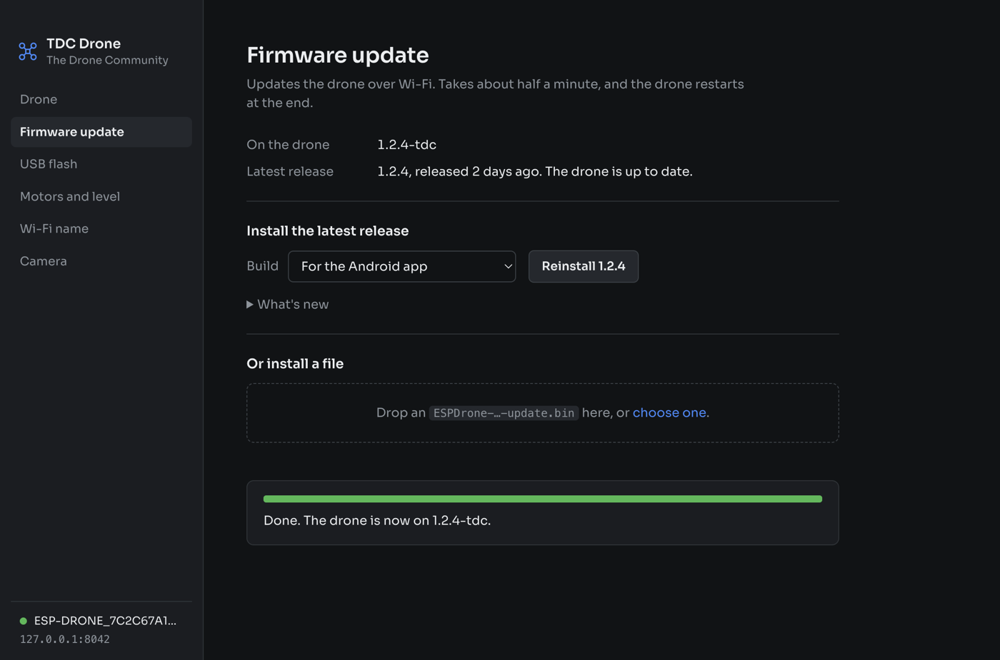

# TDC Drone (desktop app)

A small desktop app for looking after the drone from a laptop: Wi-Fi firmware updates,
USB flashing for new boards, the motor test, level calibration, the Wi-Fi name and the camera.
Mac, Windows and Linux (Electron).



## Using it

Join the drone's Wi-Fi (`ESP-DRONE_...`, password `12345678`) and open the app. It finds the
drone at 192.168.43.42 by itself.

- **Drone**: battery, state, firmware, sensors and level trim, plus Find my drone and Restart.
- **Firmware update**: installs the latest GitHub release over Wi-Fi, or any
  `ESPDrone-...-update.bin` you drop on it. It reads the version from the file first and refuses
  anything that isn't drone firmware.
- **USB flash**: for a new board or a drone that won't boot. Plug the XIAO in with the battery
  off and it writes the full image straight from the app (esptool-js, no Python needed).
- **Motors and level**: click a motor on the diagram to spin it, or run all four. Props off.
- **Wi-Fi name**: rename the drone and change its password.
- **Camera**: live view and photos on the XIAO ESP32-S3 Sense.

Everything that moves motors or changes settings only works while the drone is disarmed.
The firmware enforces that, not just the app.

## Running from source

```bash
cd desktop-app
npm install
npm start
```

No drone around? `npm run mock` starts a fake one on 127.0.0.1:8042. Click the address at the
bottom of the sidebar and enter `127.0.0.1:8042`.

## Building

```bash
npm run dist:mac      # dist/TDC Drone-<version>-arm64.dmg and .zip
npm run dist:win      # installer and portable .exe
npm run dist:linux    # AppImage
```

The Mac build isn't signed, so the first time you open it right-click the app and pick Open.
