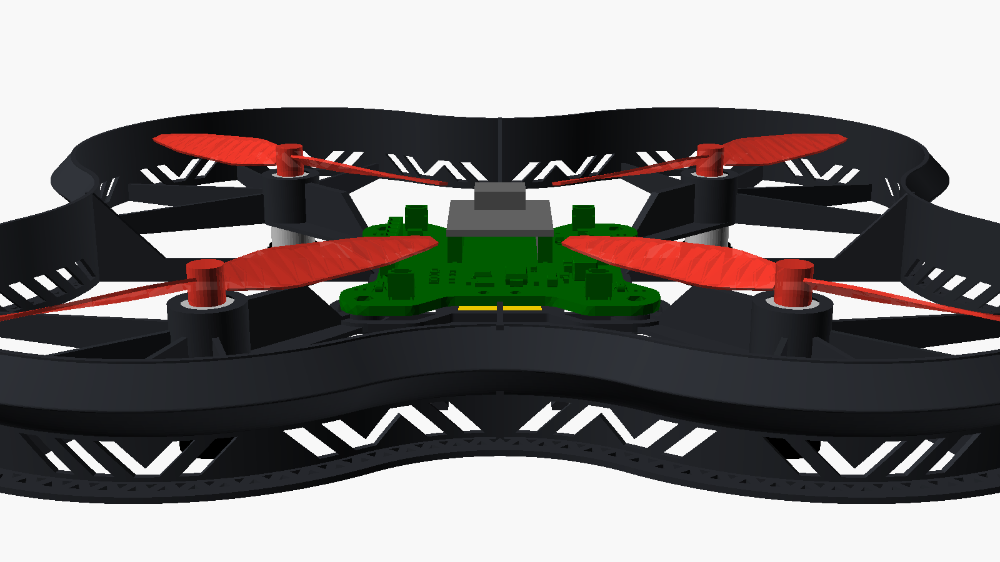
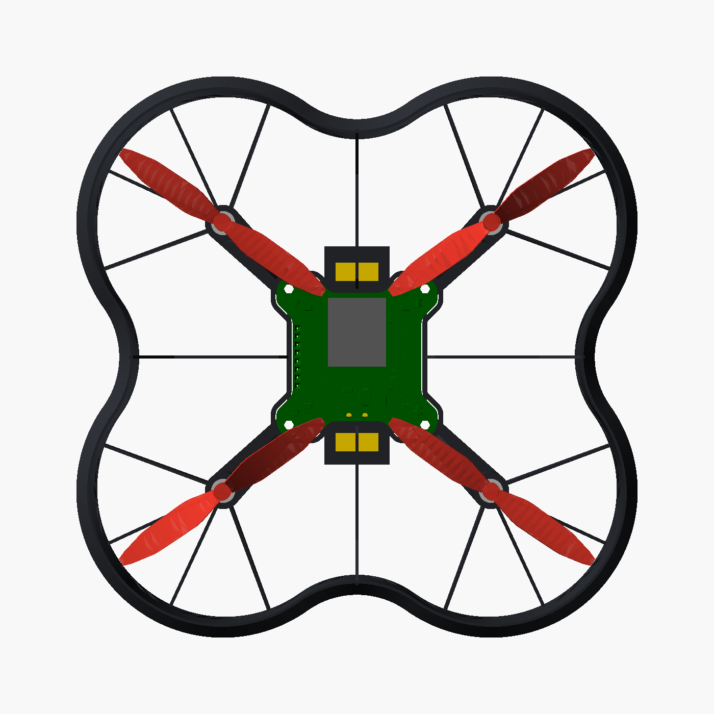
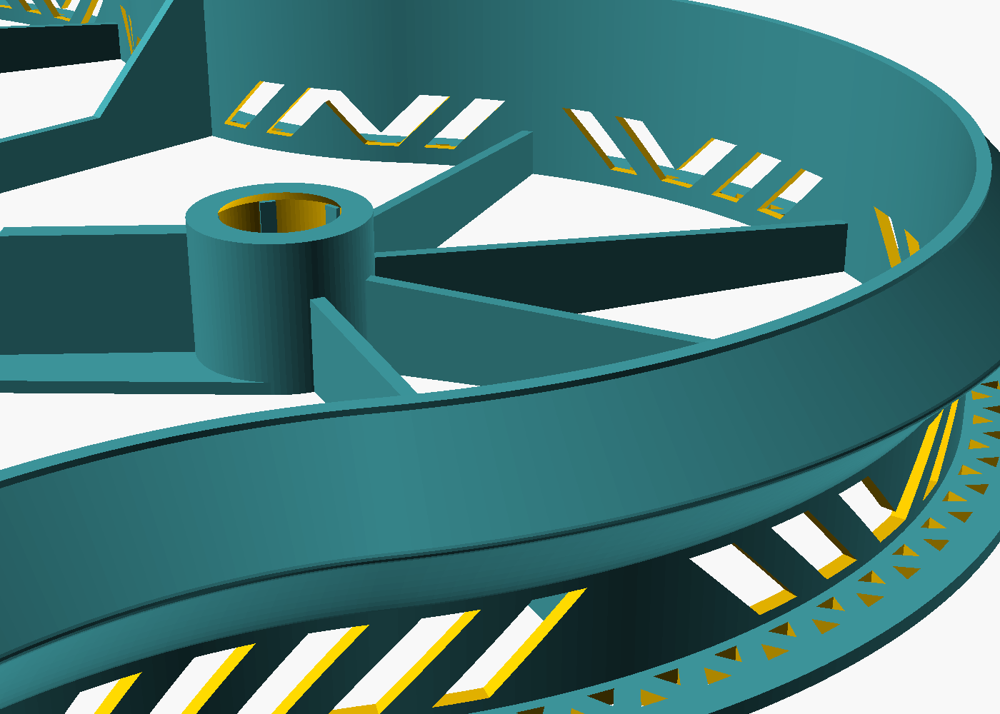

# Frames

Two 3D-printable TPU frames for PCB1 and 8520 coreless motors.

| Frame | Size | Printed mass | Status |
|---|---|---|---|
| [**v2 Strong**](v2-strong/) | 94 × 94 mm box frame | About 22 g | **Recommended.** Flight-tested with a GNB 550 mAh 1S battery |
| [75 mm ducted](#8520-brushed-tpu-ducted-frame-for-pcb1-75-mm-props) (below) | 172 × 172 mm, ducted props | About 26 g | Alternative design with ducted 75 mm props |

---

# 8520 brushed TPU ducted frame for PCB1 (75 mm props)

Parametric OpenSCAD frame for the XIAO ESP32-S3 drone PCB1, 8520 coreless motors,
75 mm propellers and a 66 x 18 x 6.5 mm 1S battery. It reuses the structural ideas
of the TinyFlex HD 75 TPU frame, re-sized for brushed motors and the 50 x 50 mm PCB.

## Files

| File | What it is |
|---|---|
| `brushed8520_tpu_frame.scad` | Parametric source. Set `part` to `frame`, `battery_holder`, `motor_boot` or `assembly`. |
| `pcb1_outline.scad` | PCB1 board outline taken from `3D_PCB1_2026-11-10.step`. |
| `stl/frame_8520_75mm_tpu.stl` | Main frame: ducts, motor collars, arms, PCB bosses. |
| `stl/battery_holder_66x18x6.5.stl` | Battery cage that bolts under the frame. |
| `stl/motor_boot_x4.stl` | Landing boot for each motor (print 4). |

## Key dimensions

| Item | Value |
|---|---|
| Overall size | 171.7 x 171.7 mm |
| Motor spacing | 82.1 mm side, 116.1 mm diagonal |
| Duct inner radius | 40.0 mm (2.5 mm tip clearance on a 75 mm prop) |
| Duct height | 15.5 mm |
| PCB mount | 4 x M3 on a 42.27 mm square, PCB underside 2 mm above the frame bottom |
| Motor collar | 8.8 mm bore with crush ribs to 8.15 mm, 45 degree seat at the top |
| Motor face | 8.95 mm above the frame bottom |
| Landing feet | Motor boots, 12.3 mm below the frame bottom, 2.2 mm below the battery cage |

## Weight (TPU at 1.21 g/cm3, from the STL volume)

| Part | Mass |
|---|---|
| Frame | 23.3 g |
| Battery holder | 1.8 g |
| Motor boots, 4 pcs | 1.1 g |
| Total printed | 26.2 g |

## Crash stiffness of the duct rim

A crash pushes the rim sideways, inward towards the prop. A plain vertical band is
stiff up and down but very soft sideways, so the first version bent into the props
under almost no load. The rim is now deep in the sideways direction instead:

- **Rolled duct lip.** The top of the duct is a closed, hollow, rounded rim that
  bulges 4.5 mm outward, like the lip on a real ducted fan. It is the upper chord of
  the rim and prints without support because no surface overhangs more than 45 degrees.
- **Outer bottom flange**, 4 mm, built as a flat truss. It is the lower chord.
- **Chevron vents** in the wall between the two chords save weight.
- **Four spokes per duct**, spread over the arc that takes the hits.
- **2.5 mm tip gap** instead of 1.5 mm.
- **T-section X arms** give each motor pod sideways stiffness back to the PCB.

Beam-model results at the weakest point of the rim. The model assumes TPU 95A at
30 MPa and an 85 g flying weight. Treat absolute values as within about 2x.
The comparison between versions is reliable.

| Version | Load before the rim touches a prop | Wall bump speed with no prop contact |
|---|---|---|
| First version | about 8 gf | 0.04 m/s |
| This version | about 560 gf | 0.4 m/s |

Hard crashes still flex the rim onto the prop tips. The prop then rubs on soft TPU
instead of hitting the wall.

## Printing

- TPU 95A, 0.4 mm nozzle, 0.2 mm layers.
- 2 walls. Every web is 2 mm or thinner, so infill hardly matters.
- No supports. Print each part flat, as exported. The duct lip never overhangs
  more than 45 degrees, and its closing cap is a 45 degree slope, not a bridge.
- 20 to 35 mm/s, minimal retraction, part cooling on.
- The frame needs a bed of at least 172 mm. It fits a 180 mm bed such as the
  Bambu A1 mini. The bottom flange gives good bed grip, so no brim is needed.

## Assembly

1. Push each motor into its collar from below until the can seats against the 45 degree
   step. Wires stay at the bottom.
2. Slip a boot over each motor bottom with the wire slot facing the frame centre.
   Route the wires up the arm to the PCB corner connector.
3. Flip the battery holder so its plate is on top and the cage hangs down.
4. Stack the battery holder under the frame and the PCB on the bosses.
   Clamp with 4 x M3 x 8 nylon screws from the top and nylon nuts under the holder.
5. Slide the battery in from the open end with the lead end last. The lead stays at
   the open end, next to the PCB battery pads, and the closed end stops the battery.
6. Press the props on. Each prop hub must be under 7.4 mm diameter to drop into the
   collar seat, and should sit 0.5 mm or more above the motor face.

## Checks done

These were checked with boolean intersections against the real PCB1 STEP model:

- Prop discs and frame: no overlap.
- Prop discs and PCB1 parts, including the corner motor connectors: no overlap.
- Frame and PCB1: contact only on the boss tops.

The prop envelope assumes the blades sit 2 to 6 mm above the motor face. If your
props hang lower, the blade root comes close to the collar rim first. Press the prop
on with a small gap, or reduce `collar_h`.

## Things to verify on your build

- **MPU6050 module.** It plugs into the 8-pin socket on the left PCB edge. If the module
  overhangs the board, it sits under the left prop discs. Keep its top below about
  10 mm above the frame bottom.
- **USB-C access.** The waist spokes stay 4 mm tall so a plug can pass over them.
  The cable leaves through a duct lattice opening.
- **Prop size.** This is built for 75 mm diameter props. If you meant the 75 mm
  whoop class with 40 to 45 mm props, set `prop_d` and re-export.
- **Lighter build.** Set `lip_w = 3.5` to save about 1 g for roughly a third less
  rim stiffness.
