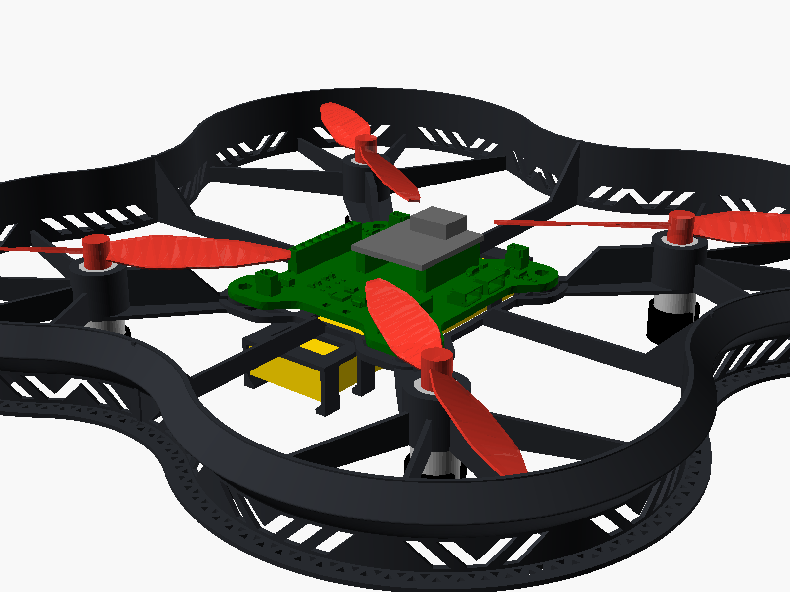

# Frames

- [v2-strong/](v2-strong/) is the one we fly and the one to print. 94 x 94 mm, about 22 g.
- The ducted 75 mm frame below is an older design. It hasn't been flown as much.

---

## Ducted frame, 75 mm props

OpenSCAD frame for PCB1 with 8520 motors, 75 mm props and a 66 x 18 x 6.5 mm 1S battery.
The layout borrows from the TinyFlex HD 75 TPU frame, resized for brushed motors and our
board.

`brushed8520_tpu_frame.scad` is the source. Set `part` to `frame`, `battery_holder`,
`motor_boot` or `assembly`. The exported STLs are in `stl/` (print 4 motor boots).
`pcb1_outline.scad` is the board outline from the STEP file.

It's 172 x 172 mm overall, so you need a bed of at least 172 mm (fits an A1 mini). Motors are
82.1 mm apart, the ducts have 2.5 mm of tip clearance on a 75 mm prop, and the board mounts
on M3 bosses on a 42.27 mm square. Printed weight is about 26 g with the battery holder and
boots.

The first version of the duct was too floppy sideways and bent into the props on any bump.
This one has a rolled hollow lip at the top and a flange at the bottom so the rim is a lot
stiffer, plus vents in the wall to keep the weight down. Hard crashes still push it onto the
prop tips.

Print it in TPU 95A, 0.2 mm, 2 walls, no supports, 20 to 35 mm/s.

Assembly: motors go into the collars from below, boots over the motor bottoms, battery holder
under the frame and the board on top, all clamped with 4x M3 x 8 nylon screws and nuts. Prop
hubs need to be under 7.4 mm to drop into the collar seat.

If your GY-521 sticks out past the board edge it ends up under the left props, so keep it
under about 10 mm tall. If you want the smaller 40 mm whoop props, change `prop_d` and
re-export.
