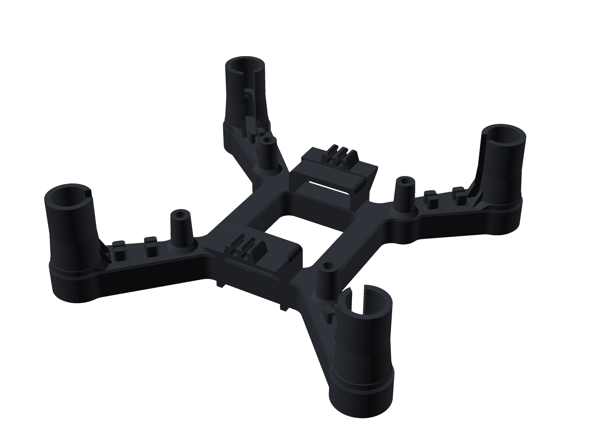

# Frame v2 Strong

This is the frame we fly. TPU 95A, 94 x 94 mm, around 22 g printed, with thicker motor cups
than the first version. Tested with a GNB 550 mAh 1S.

`frame_v2_strong.stl` is ready to print. The OpenSCAD source is `frame_v2_strong.scad`
(it pulls in `frame_outline.scad`), and the sizes you'd want to change are at the top.
`BambuStudio_A1_TPU_0.20mm.json` is the process profile we print with on an A1.

Print settings: 0.2 mm layers, 2 walls, 100% zig-zag infill, outer wall around 25 mm/s,
no supports, flat on the base. Go slow, TPU strings badly when pushed.

Motors are 80 mm apart (113 mm diagonal) with 8.6 mm cups. The board sits on four M3
standoffs on a 42.27 mm square, and the battery goes underneath in the two strap loops.

Assembly:

1. Push the motors into the cups from the top with the wire through the slot. M1 (front
   right) and M3 (rear left) are the CW ones.
2. Run the wires along the arm clips to the board.
3. Slide the battery through the straps and press the leads into the grips.
4. Screw the board on with USB-C at the front. Rubber M3 grommets between the board and
   standoffs are worth it, they keep vibration off the IMU and it drifts less. Plain screws
   work too.
