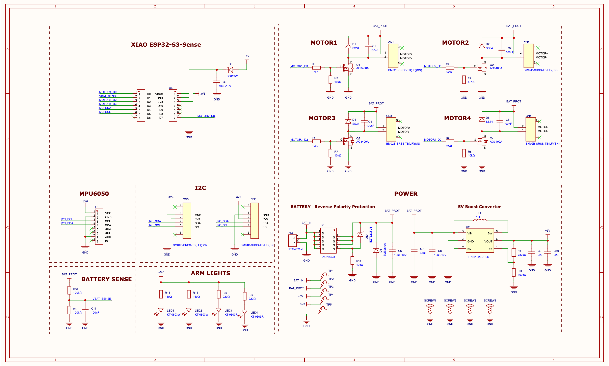

# PCB1

50 x 50 mm, 2 layer board. The XIAO ESP32-S3 sits on top, a GY-521 module plugs into its
own header, and the four motors plug straight into the corners. Designed in EasyEDA.

- `schematic/`: schematic PNG and netlist
- `gerber/`: Gerber zip, upload it to JLCPCB / PCBWay as is
- `bom/`: BOM with LCSC part numbers (xlsx, plus a csv copy so it shows on GitHub)
- `assembly/`: pick and place file
- `3d/`: STEP of the assembled board

## On the board

- 4x AO3400A low-side MOSFETs with SS34 flyback diodes for the motors, JST SH 2-pin plugs
- XT30 for a 1S LiPo, AON7423 for reverse polarity and an SMBJ5.0A TVS
- TPS61023 boost to 5V for the XIAO
- 100k/100k divider for battery voltage
- 2 Qwiic ports (JST SH 4-pin, 3.3V I2C) for a height sensor or anything else
- 4 LEDs that are on whenever the battery is in
- M3 holes on a 42.27 mm square

USB and battery both end up on the XIAO's 5V pin, so never plug in both.

## Pins

| | XIAO pin | GPIO |
|---|---|---|
| M1 front right, CW | D3 | 4 |
| M2 rear right, CCW | D7 | 44 |
| M3 rear left, CW | D2 | 3 |
| M4 front left, CCW | D0 | 1 |
| SDA (IMU and Qwiic) | D4 | 5 |
| SCL | D5 | 6 |
| Battery sense | D1 | 2 |

The M2 net is called `MOTOR2_D8` in the design but it goes to D7. The firmware already
uses GPIO 44. The MPU-6050 is at 0x68. USB-C faces the front of the drone.

## Ordering

For just the bare board, upload the Gerber zip and keep the defaults (2 layers, 1.6 mm,
HASL). If you want the fab to place the SMD parts, also upload the BOM and pick and place
files, and check the rotation of the diodes, MOSFETs and LEDs in the preview before paying.
The headers, motor plugs and XT30 are easy to solder by hand if through-hole costs extra.

C3, C6 and C8 (10 µF) are missing an LCSC number in the BOM. We used CL10A106KP8NNNC,
LCSC C19702.

Also needed: the XIAO (Sense if you want camera), a GY-521 (MPU6500 clones work), 4x 8520
motors, 75 mm props, a 1S XT30 LiPo (we use GNB 550 mAh), the [frame](../frame/v2-strong/),
and ideally rubber M3 grommets. Optional VL53L1X or VL53L0X for altitude hold.

## License

[CERN-OHL-S-2.0](LICENSE). You can make and sell boards from this, but share your changes
to the design under the same license.
