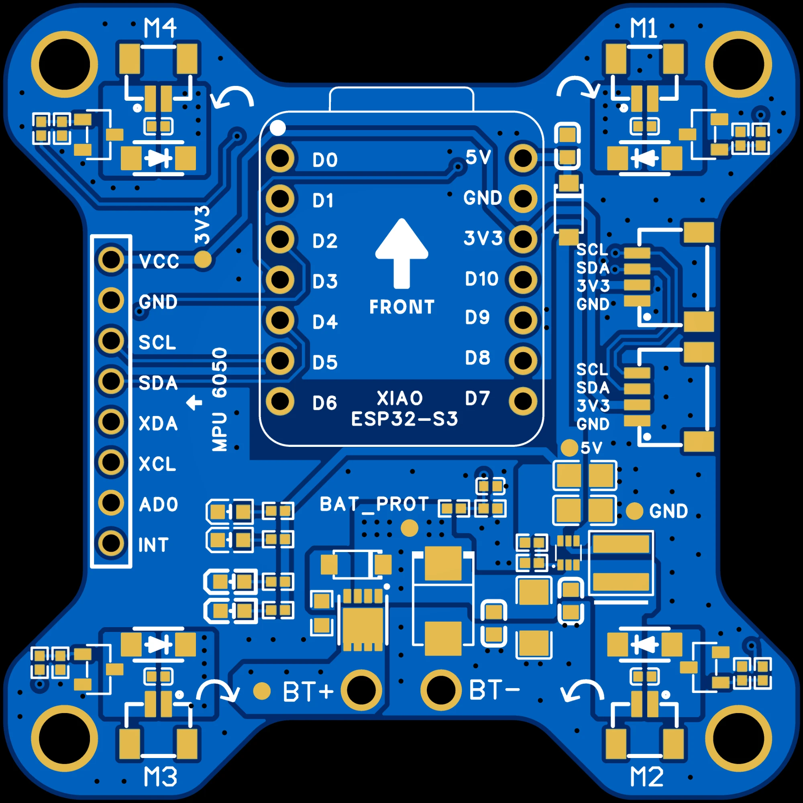

# PCB1: the flight board

PCB1 is a 50 × 50 mm, 2-layer flight board for brushed micro quads. A Seeed XIAO ESP32-S3
plugs in on top as the brain, a GY-521 (MPU-6050) module plugs into its own header as the
motion sensor, and four coreless motors plug straight into the board.

## Files

| Folder | File | What it's for |
|---|---|---|
| [`schematic/`](schematic/) | `Schematic_PCB1_2026-11-21.png` | Circuit diagram (shown below) |
| | `Netlist_PCB1_2026-11-17.tel` | Netlist, for checking connections |
| [`gerber/`](gerber/) | `Gerber_PCB1_2026-11-21.zip` | Upload as-is to a PCB fab to order the bare board |
| [`bom/`](bom/) | `BOM_PCB1_2026-11-21.csv` / `.xlsx` | Bill of materials, with LCSC part numbers |
| [`assembly/`](assembly/) | `PickAndPlace_PCB1_2026-11-21.csv` / `.xlsx` | Part positions, for machine assembly |
| [`3d/`](3d/) | `PCB1_2026-11-21.step` | 3D model of the assembled board, for CAD and frame design |

The board was designed in EasyEDA. The CSV files are the same data as the Excel files,
so you can read them right here on GitHub.

## Schematic

Click the image for full size.

## What's on the board

| Block | Parts | Notes |
|---|---|---|
| Brain | XIAO ESP32-S3 on 2 × 7-pin headers (U3, U4) | USB-C end faces the **front** of the drone |
| Motion sensor | GY-521 / MPU-6050 module on an 8-pin header (U1) | I²C, address 0x68 (AD0 to GND) |
| Motor drivers | 4 × AO3400A MOSFET (Q1–Q4) + SS34 flyback diode each | One per motor, PWM from the XIAO |
| Motor plugs | 4 × JST SH 1.0 mm 2-pin (CN1–CN4) | For 7xx / 8520 coreless brushed motors |
| Battery | XT30 socket (CN7) | 1S LiPo only (3.7 V nominal, 4.2 V full) |
| Protection | AON7423 reverse-polarity MOSFET (Q5), SMBJ5.0A TVS (D6) | Survives a battery plugged in backwards |
| Power for the XIAO | TPS61023 5 V boost converter (U2, L1) | Feeds the XIAO's 5 V pin from the 1S pack |
| Battery voltage sense | 100 k / 100 k divider (R11, R12) | Read on D1 / GPIO 2 |
| Add-on ports | 2 × Qwiic, JST SH 1.0 mm 4-pin (CN5, CN6) | 3.3 V I²C: height sensor and other add-ons |
| Lights | 2 white + 2 red LEDs | On whenever the battery is connected |
| Mounting | 4 × M3 holes on a 42.27 mm square | Fits both frames in [`../frame`](../frame) |

> **Never connect USB and the battery at the same time.** The boost converter drives the
> XIAO's 5 V pin, which is the same line USB uses. With both plugged in the battery gets
> charged from the computer and the USB port can shut down.

## Pin map

| Function | XIAO pin | GPIO |
|---|---|---|
| Motor M1, front right (spins CW) | D3 | 4 |
| Motor M2, rear right (spins CCW) | D7 | 44 |
| Motor M3, rear left (spins CW) | D2 | 3 |
| Motor M4, front left (spins CCW) | D0 | 1 |
| I²C SDA (IMU + both Qwiic ports) | D4 | 5 |
| I²C SCL | D5 | 6 |
| Battery sense | D1 | 2 |

The motor 2 net is labelled `MOTOR2_D8` in the design but lands on **D7**. The firmware
already uses GPIO 44.

## Order the board

**Bare PCB only (cheapest):**

1. Go to a PCB fab such as JLCPCB or PCBWay and choose *Order PCB*.
2. Upload `gerber/Gerber_PCB1_2026-11-21.zip` without unzipping it.
3. Keep the defaults: 2 layers, 1.6 mm FR-4, HASL. Pick any solder mask colour.
4. Order, then solder the parts from the BOM yourself.

**PCB plus assembly of the small parts:**

1. Upload the Gerber zip as above and switch on *PCB Assembly* (top side).
2. Upload `bom/BOM_PCB1_2026-11-21.xlsx` as the BOM.
3. Upload `assembly/PickAndPlace_PCB1_2026-11-21.xlsx` as the pick-and-place (CPL) file.
4. Check each part's position and rotation in the fab's preview before paying.
   The diodes, MOSFETs and LEDs must face the right way.
5. Leave the XIAO headers (U3, U4), the IMU header (U1), the motor plugs and the XT30
   for hand soldering if your fab charges extra for through-hole parts.

The three 10 µF capacitors (C3, C6, C8) have no LCSC number in the BOM. Use Samsung
CL10A106KP8NNNC, which is LCSC part C19702.

## Parts that aren't on the board

| Part | Qty | Notes |
|---|---|---|
| Seeed XIAO ESP32-S3 | 1 | The *Sense* version adds a camera for live video |
| GY-521 MPU-6050 module | 1 | Clone modules with MPU6500-family chips work too |
| 8520 coreless brushed motors with JST SH 2-pin plugs | 4 | 2 clockwise + 2 counter-clockwise |
| 75 mm propellers | 4 | 2 CW + 2 CCW: M1 and M3 CW, M2 and M4 CCW |
| 1S LiPo battery with an XT30 plug | 1 | Tested with a GNB 550 mAh 1S pack |
| TPU frame | 1 | Print [`../frame/v2-strong/frame_v2_strong.stl`](../frame/v2-strong/) |
| M3 screws | 4 | Board to frame |
| VL53L1X or VL53L0X height sensor (optional) | 1 | Plugs into CN5 or CN6 for altitude hold |

## License

The hardware design files in this folder are licensed under the
[CERN Open Hardware Licence Version 2 - Strongly Reciprocal](LICENSE) (CERN-OHL-S-2.0).
You may build, modify and sell boards made from them, as long as you share your modified
design files under the same licence.
